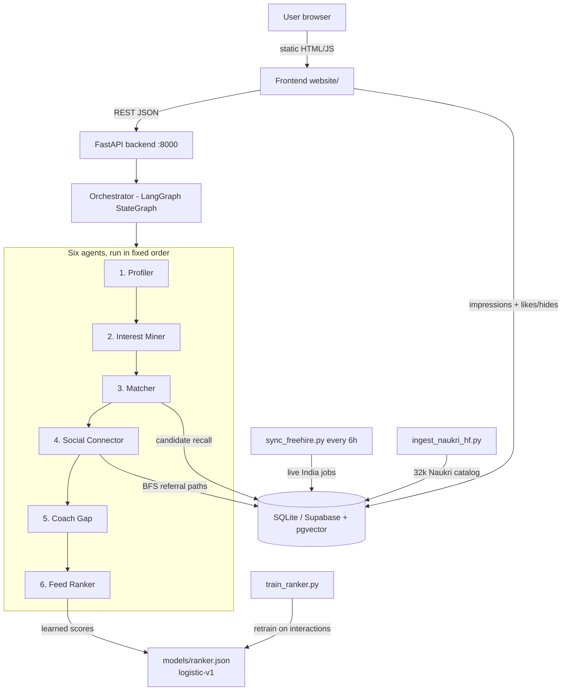

# Bharat Career Twin — Agentic Job Recommendation System

An India-focused, explainable, social-aware career network. Six cooperating AI agents
turn a resume and user behaviour into a ranked feed of **jobs, government schemes,
nearby peers, and startup collaborations** — every card carries a "why" explanation.

**Academic summary:** a learned, interaction-based ranking model predicts job
relevance, while six agents orchestrate profile parsing, interest mining, candidate
retrieval, social referral paths, skill-gap coaching, and transparent feed ranking.

---

## 1. System architecture



Three layers:

| Layer | Folder | Technology |
|---|---|---|
| Frontend | `website/` | Zero-build static HTML/CSS/JS, Bharat-themed design system |
| Backend | `backend/` | Python FastAPI + LangGraph orchestration + dependency-free ML |
| Data | `data/`, `supabase/` | SQLite (local demo) or Supabase Postgres + pgvector (production-shaped) |

Every component has a **deterministic local fallback**, so the demo runs with no
API keys, no internet, and no model downloads — external providers (Groq LLM,
Supabase, pgvector, MyScheme) upgrade it when credentials are configured in
`backend/.env`.

## 2. The six-agent pipeline (how each agent is built)

The orchestrator (`backend/app/agents/graph.py`) runs a LangGraph `StateGraph`
whose nodes share one `AgentState` dataclass. If LangGraph is not installed, an
identical sequential loop runs instead. `/api/feed` returns the full `agent_trace`
so every ranking decision can be audited step by step.

### Agent 1 — Profiler (`agents/profiler.py`)
Turns a raw resume (text or PDF) into structured profile JSON.
- **PDF extraction** via PyMuPDF with a plain-text fallback.
- **Local deterministic parser**: regex + keyword extraction of skills, education,
  experience, projects, and an ATS-style 0–100 score with strengths/gaps.
- **Optional Groq mode**: with `GROQ_API_KEY` set, an LLM (llama-3.1-8b-instant,
  temperature 0.1) returns the same JSON schema via structured-output prompting;
  the local parser remains the fallback and validator.

### Agent 2 — Interest Miner (`agents/interest_miner.py`)
Builds the user's "taste DNA" from explicit and implicit signals.
- Merges declared interests/hate chips with the interaction history
  (likes, saves, applies, hides + hide reasons) from the database.
- Produces weighted interest tags and a **hate memory**: anything the user hid is
  recorded as a boundary and excluded from future feeds regardless of model scores.
- Optionally emits embeddings for vector retrieval when an embedding provider is on.

### Agent 3 — Matcher (`agents/matcher.py`)
The candidate-recall boundary: from 32k+ items down to ~200 candidates, cheaply.
- **Supabase mode**: pgvector nearest-neighbour RPCs — `match_jobs` (100),
  `match_schemes` (50), `match_users` (30), `match_startups` (20).
- **Local mode**: deterministic lexical overlap scoring between user
  skills/interests and item skills/title/category, ordered by overlap then freshness.

### Agent 4 — Social Connector (`agents/social_connector.py`)
Adds the "social network" layer to every candidate.
- Computes haversine distance for peers (powers the 5/20/50 km "Nearby Tribe" filter).
- Counts **mutual connections** by intersecting `social_edges`.
- Runs a **bounded BFS** over the social graph + `user_employment` tables to find a
  referral path (You → Priya → TCS employee) and emits a Hinglish referral draft.

### Agent 5 — Coach Gap (`agents/coach_gap.py`)
Explainability + actionable coaching.
- Diffs user skills against each job's requirements to list missing skills.
- Maps each gap to a free course (NPTEL/SWAYAM/YouTube) with a 2-week plan from a
  curated `skill_courses` mapping; optional capped Groq enhancement.
- Powers the counterfactual card: *"82% match → 94% if you learn Docker."*

### Agent 6 — Feed Ranker (`agents/ranker.py`) — the core recommendation engine
Two-stage scoring, then diversification:

1. **Learned model** — loads `models/ranker.json` (logistic-v1) and scores every
   job on an 11-feature vector: `relevance, skill_overlap, location_match, social,
   freshness, popularity, eligibility, hate, referral, feedback, is_job`.
   The learned score is blended with the hand-weighted rule score.
2. **Hard guardrails** — explicit hate/boundary items are suppressed **before** the
   model can override them; a learned score never overrides a user's "never show me this".
3. **MMR diversity reranking** (λ = 0.7 relevance / 0.3 diversity) prevents ten
   identical "Python Developer" cards in a row.
4. **Explainability** — every card ships its breakdown (model score, rule score,
   per-feature values) and human-readable reasons; non-job cards (schemes, peers,
   startups) use transparent published rule weights.

The ranker backend and model version (`learned-logistic+guardrails`, `logistic-v1`)
are reported in the API response, the agent trace, and the Simulation Lab UI.

## 3. The learned ranker and training pipeline

The trainable model lives in `backend/app/learning.py` — a **dependency-free
logistic regression** (no scikit-learn required) over the 11 features above.

**How training works:**

1. **Data contract** — interactions CSV (`user_id, item_id, action, timestamp`)
   plus optional user and item catalogs. The loader accepts CSV/JSON/JSONL and
   alias column names (CareerBuilder/JTH/XING-shaped exports work directly).
2. **Label mapping** — each action maps to a graded target:
   `impression 0.00 → view 0.18 → click 0.35 → like 0.55 → share 0.65 →
   save 0.72 → apply 0.92 → referral 1.00`; hide/delete are hard negatives.
   Impressions are exposure records — an item the user *never saw* is never
   treated as a dislike.
3. **Temporal split** — data is sorted by time; the model trains on earlier
   events and validates on later ones, so evaluation never leaks the future.
4. **Metrics** — NDCG@10, Recall@10, MRR per user, written into the artifact.

**Current results** (`training/evaluation_report.md`, same temporal split for all):

| Strategy | NDCG@10 | Recall@10 | MRR |
|---|---|---|---|
| popularity baseline | 0.4397 | 0.7556 | 0.3639 |
| hand-tuned hybrid rules | 0.4868 | 0.7742 | 0.4209 |
| **learned logistic ranker** | **0.4871** | 0.7701 | **0.4202** |

The trained artifact (`backend/models/ranker.json`) is committed, so a fresh clone
ranks with the learned model out of the box.

**Data provenance (stated honestly):**
- **Job catalog — real**: 32,013 Naukri.com India listings (HuggingFace
  `muhammetakkurt/naukri-jobs-dataset`, CC-BY-NC-4.0) + live freehire.me postings,
  filtered to India/remote.
- **Interaction labels — simulated**: `app/cron/simulate_interactions.py` generates
  19,615 events from 400 simulated users acting on the *real* catalog (realistic
  skill/city distributions, graded actions, hate-triggered hides). These numbers
  demonstrate the pipeline; they are not real-world benchmarks.
- **Upgrade path — ready**: download the Kaggle
  [CareerBuilder Job Recommendation Challenge](https://www.kaggle.com/c/job-recommendation)
  (~50k users, ~200k real applications), run
  `python -m app.cron.convert_careerbuilder --data-dir <folder>`, and retrain on
  genuine labels with one command.

## 4. Data and freshness pipeline

| Script | Purpose |
|---|---|
| `app/cron/ingest_naukri_hf.py` | Ingest the 32k real Naukri JSONL export (date/HTML sanitising, skill parsing) |
| `app/cron/sync_freehire.py` | Sync live postings from the freehire.me public API, **India/remote filter on** |
| `app/cron/simulate_interactions.py` | Generate training interactions over the real catalog |
| `app/cron/export_training.py` | Export real product events (impressions + actions) to training CSVs |
| `app/cron/train_ranker.py` | Train + evaluate + save the ranker artifact |
| `app/cron/evaluate_baselines.py` | Popularity vs rules vs learned comparison on one split |
| `app/cron/convert_careerbuilder.py` | Convert the Kaggle CareerBuilder TSV export |
| `app/cron/auto_refresh.py` | 6-hour loop: refresh live jobs + guarded retrain (≥50 interactions) |

Double-click **`START_PROJECT.bat`** to run everything, **`AUTO_REFRESH.bat`** to
keep the catalog fresh.

**Exposure-aware learning loop:** every displayed card is logged via
`POST /api/impressions` (rank position, candidate source, model version, surface).
Likes/saves/hides go through `POST /api/interactions`. `export_training.py` joins
both into the training set, so the model learns from *what was actually shown*,
not from a biased action log — this closes the loop:

```
product use → impressions/actions → export → retrain → new ranker.json → better feed
```

## 5. Storage layer

- **Local demo (default)**: SQLite (`data/bharat_twin.db`) with 13 tables — users,
  jobs, schemes, peers, startups, social_edges, user_employment, interactions,
  **impressions**, agent_memory, referral_requests, notifications. Seeded demo
  users (`demo_fresher`, `demo_govt`, `demo_founder`) via `X-Demo-User` header.
- **Production-shaped**: `supabase/migrations/01_schema.sql` adds pgvector 384-d
  embeddings, HNSW-ready indexes, the four `match_*` RPC functions, row-level
  security policies, and Supabase Auth. Selected with `BCT_STORE_BACKEND=supabase`.

## 6. API surface (36 endpoints)

Core groups (full contracts in code at `/docs` when the server runs):

```
GET  /api/feed?offset&limit&type&steer     ranked feed + agent_trace + backends
POST /api/interactions                     like/save/hide/apply/view/share
POST /api/impressions                      exposure logging for training
GET  /api/model/status                     ranker backend, version, metrics
POST /api/resume/parse                     Profiler agent (PDF/text)
GET  /api/jobs/recent?days                 freshness-filtered recent jobs
GET  /api/peers/nearby|referral-path|graph/ego   social layer
GET  /api/schemes, /api/startups           schemes + startup bazaar
POST /api/sync/freehire, /api/ingest/jobs|schemes   admin ingestion
GET  /api/stats                            users, jobs by source, impressions, CTR
```

## 7. Frontend

`website/` is an intentional **zero-build static site** (no npm, no bundler):
`index.html` + `style.css` + `app.js`. It implements the mixed feed
(job/scheme/peer/startup cards), steer box, focus modes, explainability sheet with
counterfactuals, referral-path modal with share/QR, interest/hate DNA chips,
nearby-tribe radius filters, canvas social graph, startup bazaar, and a Simulation
Lab showing live model telemetry. It calls the backend API and falls back to
built-in demo cards when the API is offline, so the UI never looks broken.

## 8. Quick start

```bash
git clone https://github.com/AgentFeed/Demo.git
cd Demo/backend
pip install -r requirements.txt
uvicorn app.main:app --port 8000
# then open website/index.html  (or double-click START_PROJECT.bat on Windows)
```

A fresh clone runs immediately: the store self-seeds demo data and the committed
ranker artifact is loaded automatically. To rebuild the full 32k-job real dataset
and retrain from scratch, see the commands below.

<details>
<summary><strong>Rebuilding the full real dataset (optional, ~190 MB download)</strong></summary>

```bash
mkdir -p data/raw
curl -L -o data/raw/naukri_ds.jsonl  "https://huggingface.co/datasets/muhammetakkurt/naukri-jobs-dataset/resolve/main/naukri_data_scientist.jsonl"
curl -L -o data/raw/naukri_swe.jsonl "https://huggingface.co/datasets/muhammetakkurt/naukri-jobs-dataset/resolve/main/naukri_software_engineer.jsonl"

cd backend
python -m app.cron.ingest_naukri_hf --all --limit 20000   # 32k real India jobs
python -m app.cron.sync_freehire                          # live India/remote jobs

python -m app.cron.simulate_interactions --users 400 --events-per-user 50
python -m app.cron.train_ranker --epochs 1500 \
  --dataset training/simulated/interactions.csv \
  --users training/simulated/users.csv \
  --items training/simulated/items.csv
python -m app.cron.evaluate_baselines --epochs 1500 \
  --dataset training/simulated/interactions.csv \
  --users training/simulated/users.csv \
  --items training/simulated/items.csv \
  --report training/evaluation_report.md
```

Real interaction labels: download the
[Kaggle CareerBuilder export](https://www.kaggle.com/c/job-recommendation), then
`python -m app.cron.convert_careerbuilder --data-dir <folder>` and retrain.
</details>

## 9. Deployment (both free)

| Part | Host | Live URL pattern |
|---|---|---|
| Frontend | **Vercel** (static CDN, never sleeps) | `https://<project>.vercel.app` |
| Backend | **Hugging Face Space** (Docker, 2 vCPU) | `https://<owner>-bharat-career-twin.hf.space` |

The frontend auto-selects its API base: on `localhost` it calls
`127.0.0.1:8000` (local backend), anywhere else it calls the Hugging Face Space
(one-line override: `PROD_API_BASE` at the top of `website/app.js`, or set
`window.BCT_API_BASE` before the script loads).

**Deploy the backend (Hugging Face Space):**

1. Create a free account on huggingface.co → New → Space → name it
   `bharat-career-twin` → SDK: **Docker** (blank template) → Public.
2. Push this repo to the Space (the repo root already contains the Space
   `README.md` frontmatter and the `Dockerfile`):

   ```bash
   git remote add space https://huggingface.co/spaces/<your-hf-username>/bharat-career-twin
   git push space main
   ```

   (Username = your HF username, password = a write token from HF Settings → Access Tokens.)
3. The image build seeds the database: demo users + **4,500 real Naukri jobs**
   (`data/demo_catalog.jsonl`, committed for exactly this purpose) + a
   best-effort live freehire sync. The trained `ranker.json` is baked in.

**Deploy the frontend (Vercel):**

1. vercel.com → sign in with GitHub → Add New… → Project → import `AgentFeed/Demo`.
2. Framework preset: **Other** (the included `vercel.json` serves `website/`).
3. Deploy — done. Update `PROD_API_BASE` in `app.js` if your Space URL differs,
   commit, and Vercel redeploys automatically.

Free-tier caveats (state them in the viva): the Space sleeps after ~48 h of
inactivity (first visitor waits ~1 minute while it wakes), and both platforms
have ephemeral disks, so interactions collected online reset on restart — the
seeded catalog and trained model rebuild automatically. The persistent demo
remains the local one via `START_PROJECT.bat`.

## 10. Tests

```bash
cd backend
BCT_DB_PATH=/tmp/bct-test.db pytest -q     # 11 passed
```

Covers the API contract, the six-agent execution order, interaction/hate memory
effects on ranking, the training loader, and the temporal evaluation metrics.

## 11. One-line pitch

> A trained interaction-based ranker works inside six AI agents to recommend jobs
> through a social graph — with explainable matches, referral paths, automatic
> live-job refresh, and Bharat-first design. The system logs impressions,
> evaluates NDCG/Recall/MRR against baselines, and falls back safely when
> providers are unavailable.
